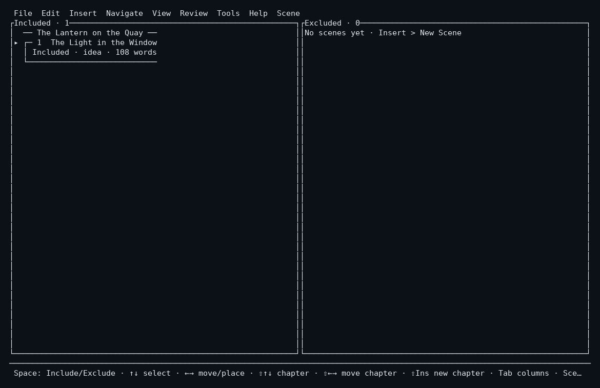
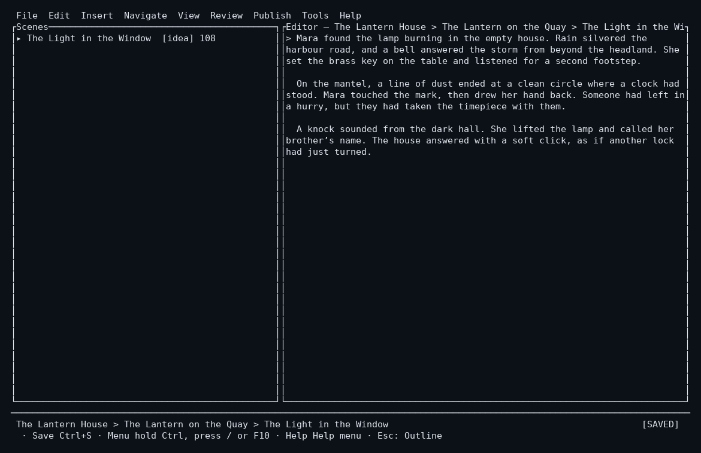

# WIDE — Writer’s IDE

**A writing workspace for planning, drafting and shaping a book.**

Writing a book involves more than drafting paragraphs. Chapters move, scenes
change, research accumulates and earlier decisions need checking. WIDE brings
manuscript writing and book planning into one local, keyboard-driven workspace.

WIDE is for fiction and non-fiction writers who want to organise a book as it
takes shape, keep planning information near the manuscript, and work with their
book files on their own computer.

## See WIDE in use

These screenshots show the application running with a synthetic demonstration
manuscript. They contain no private manuscript material.



*Fiction planning: a chapter and scene from the synthetic “The Lantern House”.*



*Drafting a short passage in the same demonstration project.*

## What you can try in the current alpha

- Create local fiction and non-fiction projects.
- Organise a manuscript with sections, chapters, prose documents and scenes.
- Plan fiction with scene cards, including moving scenes and retaining excluded
  material.
- Draft and save prose in the terminal editor, then return to the outline.
- Keep characters, plotlines, research and other planning records in the project.
- Compile manuscripts to formats supported by the current build, including
  EPUB, DOCX and PDF.

The application also has experimental Scrivener and other manuscript import
workflows. Import coverage and publication fidelity are still being tested
against real projects; the current import status is described in the developer
documentation.

## Current status

WIDE is pre-release alpha software under active development towards v1.0. Core
writing, planning, import and publishing workflows are still being integrated
and checked. Passing automated tests does not establish that the interface is
ready for everyday authoring, and human acceptance remains outstanding for
several workflows.

Do not use an alpha build as the only copy of a manuscript. Keep independent
backups of your work and retain the source project when testing an import.
There is not yet a supported packaged release or a general platform support
claim.

## Try a development build

The current development build targets Linux. It requires a Rust toolchain and
the dependencies fetched by Cargo. From a clone of this repository:

```sh
cargo run -p writers-ide-terminal
```

This opens the start screen. Choose **File → New Project** to create a book.
To open an existing WIDE project directly, pass its project directory:

```sh
cargo run -p writers-ide-terminal -- /path/to/your/project
```

This is a source-tree development route, not a packaged installer. See the
[getting-started guide](docs/GETTING_STARTED.md) for the current first-project
workflow and the [developer guide](docs/DEVELOPMENT.md) for build and test
details.

## Your work stays local

WIDE stores project data on the local filesystem. Its normal writing workflow
does not require a cloud account or an internet connection after dependencies
have been installed. Optional model assistance is separate from core writing
and is not required to use the application.

## Documentation and feedback

- [Getting started with WIDE](docs/GETTING_STARTED.md)
- [Developer documentation](docs/DEVELOPMENT.md)
- [Current development status](docs/DEVELOPMENT_STATUS.md)
- [Report a problem or usability issue](https://github.com/rdearman/WritersIDE/issues)

WIDE is being shaped around real writing workflows. Reports about confusing
navigation, editing behaviour, imports and compiled books are especially
useful while the application is in alpha.
